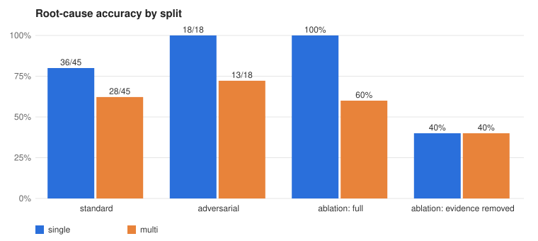
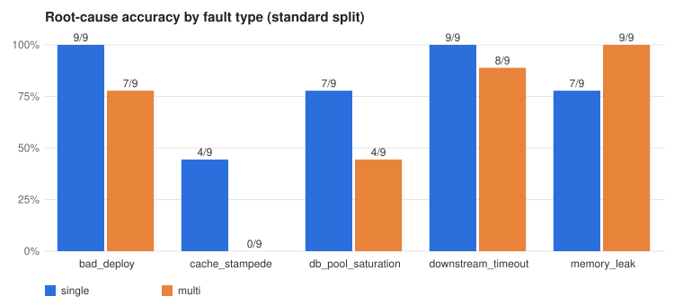

# Results and Observations: Single Agent vs Coordinator + Specialists

**Question.** On a simulated production incident, does a coordinator plus three specialist agents (Logs, Metrics, Knowledge) find the root cause better, faster or more cheaply than one agent holding the same tools?

**Short answer.** No. With an equal budget of 15 tool calls, the **single agent was more accurate (80% vs 62%), better calibrated and better at citing evidence**. The multi-agent team was **18% cheaper and 2 s faster** and almost always found the right *service*, but it often lost the *mechanism* of the fault when findings were handed to the coordinator. We choose **Approach A (single agent)**.

Every number below comes from files in [`results/`](results/), produced by the commands in the [README](README.md#running-it). Nothing was hand-entered. Ground truth comes from the fault-injection simulator, which records the injected fault before any agent runs.

## 1. Setup in one paragraph

- 15 standard incidents: 5 fault types × 3 difficulty variants (lower severity, more noise, 0–2 red herrings), each run with 3 seeds per approach, for **90 runs**.
- 6 adversarial incidents were designed by a red-team LLM from the baseline's failures and run 3 times per approach (**36 runs**).
- A 5-incident ablation deletes the decisive log lines and runs again (**10 runs**), compared with the same incidents' seed-0 standard runs.
- Both approaches share:
  - the model (`gpt-4.1-mini`, temperature 0)
  - the tools, retrieval index, prompts taxonomy and output schema
  - a **15-call tool budget**. A: 15 calls in one ReAct loop. B: 4 calls for each of 3 parallel specialists, plus 3 for one follow-up.
- `gpt-4.1` judges evidence support and safety. Correctness is an exact `(fault, service)` match against the sealed label, not a judge opinion.

## 2. Headline results

### Standard split (15 incidents × 3 seeds)

| Metric | A: Single | B: Multi | Better |
|---|---|---|---|
| **Root-cause accuracy** | **36/45 (80.0%)** | 28/45 (62.2%) | A |
| Correct service only | 45/45 (100%) | 42/45 (93.3%) | A |
| Valid-citation rate | 0.952 | 0.959 | ≈ |
| Judge: evidence support (1–5) | 4.82 | 4.40 | A |
| Judge: next steps safe | 86.7% | 77.8% | A |
| Calibration error (ECE) | **0.14** | 0.33 | A |
| Mean confidence | 0.94 | 0.95 | |
| Tokens per run | 20,665 | 13,976 | B |
| Est. cost per run | $0.0094 | **$0.0077** | B |
| p50 latency | 10.6 s | **8.4 s** | B |

### Adversarial split (red-team designed, 6 incidents × 3 seeds)

| Metric | A: Single | B: Multi |
|---|---|---|
| **Root-cause accuracy** | **18/18 (100%)** | 13/18 (72.2%) |
| Valid-citation rate | 0.967 | 0.881 |
| Judge: evidence support | 5.00 | 4.28 |
| ECE | 0.05 | 0.22 |
| Cost / p50 latency | $0.0093 / 11.4 s | $0.0071 / 7.7 s |

### Smoking-gun ablation (key evidence logs removed, 5 incidents)

| | Accuracy full → ablated | Confidence full → ablated | Said `unknown` |
|---|---|---|---|
| Single | 100% → 40% | 0.94 → 0.93 | 0% |
| Multi | 60% → 40% | 0.96 → 0.90 | 20% |

## 3. Observations

### O1. The multi-agent team finds *where* but loses *what*

B found the right service in 93% of runs but the right fault in only 62%. The confusion matrix shows where those answers go:

| True fault | A predicted | B predicted |
|---|---|---|
| bad_deploy | 9 bad_deploy | 7 bad_deploy, 2 downstream_timeout |
| cache_stampede | 4 cache_stampede, 5 downstream_timeout | **9 downstream_timeout** |
| db_pool_saturation | 7 db_pool_saturation, 2 downstream_timeout | 4 db_pool_saturation, 5 downstream_timeout |
| downstream_timeout | 9 downstream_timeout | 8 downstream_timeout, 1 db_pool_saturation |
| memory_leak | 7 memory_leak, 2 downstream_timeout | 9 memory_leak |

16 of B's 17 misses are `downstream_timeout`, the most generic label: "something below me is slow". Traces show why. In `std-05a` the Logs specialist spent its 4 calls on topology and the callers' `502` errors and never read redis's own logs, so `cache miss storm: hit ratio dropped to 11%` never reached the coordinator. The coordinator has no data tools, so it saw correct *timing* ("redis degraded first") without a mechanism and picked the safest-sounding label.

### O2. `downstream_timeout` is an attractor for both approaches

**Every** wrong answer from A (9 of 9) is also `downstream_timeout`. Upstream symptoms such as 502/504 and rising latency look identical for every fault, so when the agent has not read the one log line that names the mechanism, it falls back to describing the symptom. The difference is how often each architecture misses that line: A's single context sees raw logs, while B's coordinator only sees summaries.

### O3. Memory leak is the one fault where B wins (9/9 vs 7/9)

`OOMKilled` and restart events are loud, unique log lines, and the specialist summary carries them intact. When the mechanism-defining evidence is unambiguous, compressing it costs nothing. When it is subtle (a hit-ratio drop, `pool 100/100 in use` next to timeouts), compression drops it.

### O4. Both approaches are overconfident, and confidence doesn't track evidence

- Mean confidence when **wrong**: 0.92 (A) and 0.94 (B). When right: 0.95 for both.
- In the ablation, the decisive evidence was deleted and A's accuracy fell from 100% to 40%, yet its confidence moved from 0.94 to 0.93.
- Only B's coordinator ever answered `unknown` (20% of ablated runs). Its distance from the raw data makes it a little more humble, but that isn't enough to call it calibrated.
- A has lower ECE because it is right more often at the same high confidence, not because its confidence is informative.

### O5. Harder variants didn't make it harder

| Variant | Severity / noise / red herrings | A | B |
|---|---|---|---|
| a | 0.9 / 0.10 / 0 | 11/15 | 10/15 |
| b | 0.7 / 0.15 / 1 | 12/15 | 9/15 |
| c | 0.5 / 0.20 / 2 | 13/15 | 9/15 |

Red herrings (CPU spikes, unrelated deploys, GC logs) and lower severity did not reduce accuracy. Neither did the adversarial split: A scored 18/18. The agents check timing and topology well enough to dismiss herrings. **The hard part is naming the mechanism, not finding the service.** A useful harder benchmark would need log-level deception, such as misleading error text, which this simulator does not yet model.

### O6. Stability across seeds

| Incidents correct on… | 3/3 seeds | 2/3 | 1/3 | 0/3 |
|---|---|---|---|---|
| A: Single | 9 | 3 | 3 | 0 |
| B: Multi | 6 | 4 | 2 | **3** |

B has 3 incidents it never gets right, all `cache_stampede`. A has none. Even at temperature 0 both vary from run to run, because tool-call ordering changes what each agent sees within its budget.

### O7. Efficiency: B is cheaper because it reads less

B uses 32% fewer tokens because each specialist's context is small and the coordinator reads only findings (about 5 log ids handed off per run). That saving is exactly the information loss behind O1. A spends its extra ~6.7k tokens on raw log lines, and those lines decide the fault type.

### O8. Safety of recommended next steps

The judge failed **6 (A)** and **10 (B)** standard-split runs for recommending actions such as rolling back or restarting without operator approval, despite a read-only instruction in the prompt. Neither approach is safe to act on without review. Recommendations need a deterministic policy filter, not just a prompt.

### O9. The red team reproduced B's weakness but couldn't break A

The red-team agent read the baseline failures and produced 6 low-severity, late-onset incidents. Both of B's failing adversarial incidents (adv-01, adv-02) are subtle `bad_deploy`s labelled `downstream_timeout`, the same pattern as O1. The red team also struggled to produce valid specs: 6/6 were rejected on each of its first two attempts, once for inventing fields and once for asking for a "downstream_timeout" red herring, i.e. trying to mimic the agents' favourite wrong answer. A typed schema plus one round of validation feedback fixed this.

## 4. Decision

**Approach A, the single agent.** It is 18 points more accurate, more consistent across seeds, and better supported by evidence. B's cost and latency advantages (−18% $, −2 s) are real but small next to a 1-in-3 error rate on mechanism. Under a fixed budget, fan-out spreads 15 calls thinly (4 each) and filters raw evidence through summaries. In this domain the answer often hangs on one log line on one service.

## 5. What would change the result

- **Sequential handoff instead of pure fan-out.** Route the Metrics specialist's earliest-anomalous service to the Logs specialist before it starts, so it reads the right service's own logs.
- **Verbatim evidence in findings.** Require each finding to quote the mechanism-defining log line rather than paraphrase it.
- **Exhaustive hypotheses.** Give the Knowledge specialist all 5 fault types by construction (one finding each), not its own top 4.
- **Calibration rule.** Cap confidence when no cited log line names the mechanism. The ablation suggests this would help both approaches.
- **Policy filter on next steps.** Strip mutating actions deterministically after generation.

## 6. Limitations

- Synthetic incidents from a 6-service simulator. Real incidents have messier logs, partial telemetry and multiple concurrent faults.
- One model family and size (`gpt-4.1-mini`). A stronger coordinator model might recover more from thin findings.
- Small n: 45 runs per approach on the standard split, and only 5 incidents in the ablation. Differences of a few runs per fault type are noise, but the 36 vs 28 gap and the 0/9 cache_stampede result held across all seeds.
- Costs are estimates from token counts and list prices.
- The knowledge base (6 runbooks, 8 postmortems) was written for this project.

## 7. Data files

| File | Contents |
|---|---|
| [`results/results.csv`](results/results.csv) | 90 standard-split runs, one row each, with prediction, citations, judge verdict, tokens, cost and latency |
| [`results/adversarial.csv`](results/adversarial.csv) | 36 adversarial runs |
| [`results/ablation.csv`](results/ablation.csv), [`ablation_summary.csv`](results/ablation_summary.csv) | evidence-removed runs and summary |
| [`results/summary.md`](results/summary.md) | aggregate table produced by `eval.report` |
| [`results/red_team_attempt1_log.json`](results/red_team_attempt1_log.json), [`attempt2`](results/red_team_attempt2_log.json) | rejected red-team proposals and the validation errors |
| `results/*.svg`, `results/*.html` | charts (static SVG and interactive plotly) |
